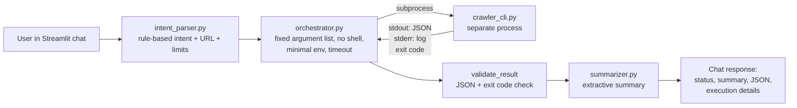

# TaskPilot AI — CLI-driven chat execution for website crawling

A chat application that turns a natural-language request ("Crawl https://example.com, summarise it and give me JSON")
into a **real CLI execution**: the backend starts a separate crawler process, monitors it, captures
stdout / stderr / exit code, validates the result and shows it in the chat.

Built for BuildSprint Round 2. Everything is free and local — no API keys, no paid services.

## How it works



| File | Role |
|---|---|
| `app.py` | Streamlit chat UI and orchestration of one task |
| `intent_parser.py` | Rule-based intent understanding: URL, summary/JSON wanted, page limit |
| `orchestrator.py` | Starts the approved CLI with `subprocess.Popen`, streams logs, enforces timeout, validates output |
| `crawler_cli.py` | **The CLI tool.** Same-domain crawler; prints one JSON document to stdout, logs to stderr |
| `summarizer.py` | Extractive summariser (sentences are copied from the crawled text) |
| `tests/test_core.py` | Offline tests (safety checks, parser, crawler, timeout, env isolation) |

### Why a custom CLI?
It keeps the demo free, deterministic and fully explainable: `crawler_cli.py` has a documented contract
(`stdout` = exactly one JSON document, `stderr` = progress log, exit codes `0` success / `2` refused input /
`3` failed / `4` partial). The orchestrator starts it as a **separate process** — it is never imported.

### Is there an LLM?
No. The "AI layer" is a deterministic intent-understanding layer (keyword/URL/number extraction) plus an
extractive summariser. This is deliberate: it needs no API key, cannot hallucinate (every summary sentence comes
from crawled text), and website content cannot prompt-inject it. It is **not** an autonomous LLM agent.

## Prerequisites
* Python 3.10+ (check with `python3 --version`)
* Internet access (to reach the site being crawled)

## Setup and run
```bash
git clone https://github.com/vishnuvardhan5337/TaskPilot-AI.git TaskPilot-AI
cd TaskPilot-AI
python3 -m venv venv
source venv/bin/activate          # Windows: venv\Scripts\activate
pip install -r requirements.txt
streamlit run app.py              # opens http://localhost:8501
```
No environment variables or secrets are needed.

## Try it
1. Click **Mandatory demo (example.com)** in the sidebar, or type:
   `Crawl https://example.com, extract the important information, give me a summary, and return the extracted data in JSON format.`
2. Open **Execution details** to see the exact command, exit code, stderr log and raw stdout.
3. Other prompts: `Summarize https://quotes.toscrape.com and crawl up to 3 pages`,
   `Crawl http://localhost:8501` (blocked), `Crawl https://this-domain-does-not-exist-12345.com` (failure handling).

Run the CLI on its own:
```bash
python crawler_cli.py --url https://example.com --max-pages 3 --output json
echo "exit code: $?"
```

Run the tests (offline):
```bash
python -m unittest discover -s tests -v
```

## Execution monitoring and failure handling
* **Status** is `success`, `partial` (some pages failed) or `failed`; the exit code is authoritative and the JSON is cross-checked.
  The app never reports success unless at least one page was really crawled.
* **Timeout:** the orchestrator kills the process after the configured timeout (default 120 s); the CLI also has its own
  90 s time budget and 10 s per-request timeout.
* **Cancellation:** the child is killed in a `finally` block, so pressing Stop in Streamlit does not leave orphan processes.
* **Bad output:** non-JSON or wrongly-shaped output is reported as a failure with the CLI's last stderr line.

## Security and responsible execution
| Risk | Mitigation |
|---|---|
| Shell injection | `shell=False`, fixed argument list; user text is never passed to the CLI — only the extracted URL and a bounded integer |
| SSRF / internal access | http(s) only; host is DNS-resolved and every IP must be public (blocks localhost, private, link-local/cloud-metadata ranges); redirects re-validated each hop; only ports 80/443/8080/8443; no embedded credentials |
| Crawling beyond scope | Same-domain only, default 3 pages (hard max 10), 2 MB per page, 90 s budget, 0.5 s delay between requests |
| robots.txt | Honoured; if robots.txt is unreachable or forbidden (401/403/5xx) the crawl is refused |
| Secrets leakage | Child process gets a minimal environment allow-list (no API keys/credentials inherited) |
| Untrusted web content | Treated as data only; scripts stripped; page text is markdown-escaped before display; it never reaches a shell or alters instructions |
| Dishonest status | Honest `partial`/`failed` states with the reason shown in chat |

Known limitations: JavaScript-rendered sites are not supported (static HTML only); DNS-rebinding between validation and
connection is not fully eliminated; the summariser is extractive and English-oriented.

## AI tools and services used
* **Claude (Anthropic)** and **ChatGPT (OpenAI)** — used for architecture planning and to help write and test the code.
  I reviewed and can explain every component.
* No external AI/LLM API is called at runtime. Libraries: Streamlit, Requests, BeautifulSoup4.
